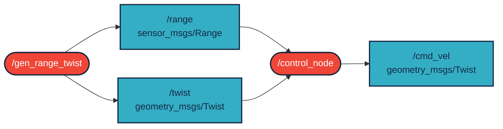

# `bog_yz5` package
ROS 2 python package.  [](https://docs.ros.org/en/humble/)

A package két node-ból áll:
- A /gen_range_twist szimulált szenzoradatokat generál egy közeledő akadályról a range (sensor_msgs/Range) topicban, valamint a jármű sebességét a twist (geometry_msgs/Twist) topicban.
- A /control_node ezeket az adatokat felügyeli: 5 és 10 méter között lelassítja a járművet, 5 méternél közelebbi akadály esetén pedig vészfékezést hajt végre a cmd_vel (geometry_msgs/Twist) topicra küldött megállási paranccsal, valamint mindaddig nyomva tartja a féket, amíg újra biztonságos távolságra nem kerül az akadálytól.


## Packages and build

It is assumed that the workspace is `~/ros2_ws/`.

### Clone the packages
``` r
cd ~/ros2_ws/src
```
``` r
git clone https://github.com/bogjoskevin/bog_yz5
```

### Build ROS 2 packages
``` r
cd ~/ros2_ws
```
``` r
colcon build --packages-select bog_yz5 --symlink-install
```

<details>
<summary> Don't forget to source before ROS commands.</summary>

``` bash
source ~/ros2_ws/install/setup.bash
```
</details>

``` r
ros2 launch bog_yz5 aeb.launch.py
```

Now `colcon build` your ROS 2 package and you can start wokring.


### Starting nodes separately (optional):
```bash
ros2 run bog_yz5 gen_range_twist
ros2 run bog_yz5 control_node
```

### Checking topics:
```bash
ros2 topic echo /range
ros2 topic echo /twist
ros2 topic echo /cmd_vel
```


## Graph


